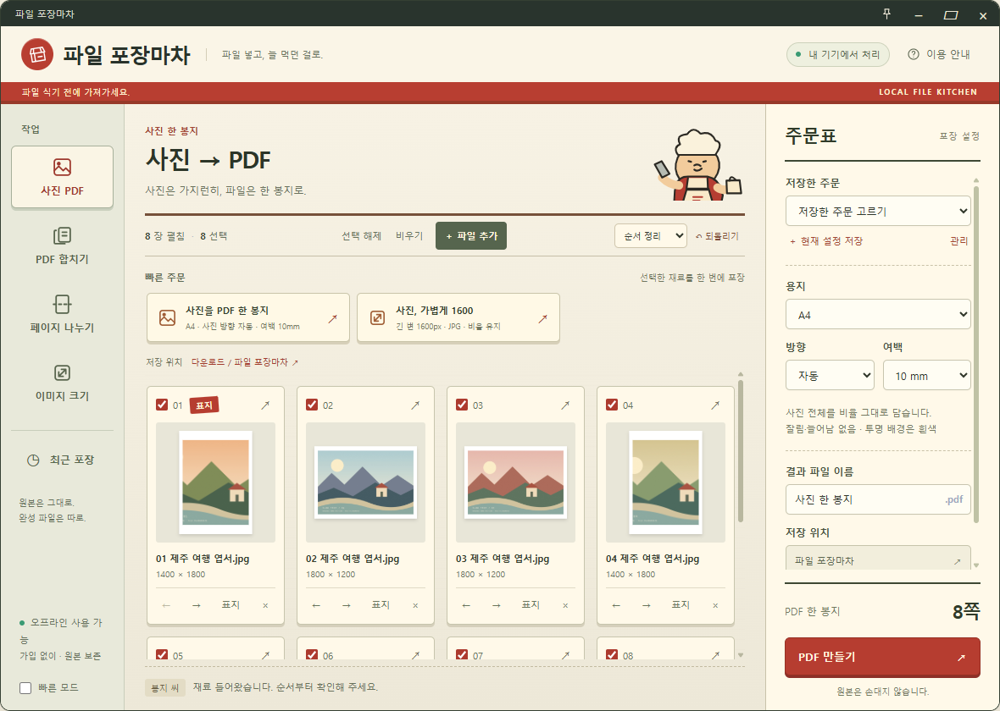
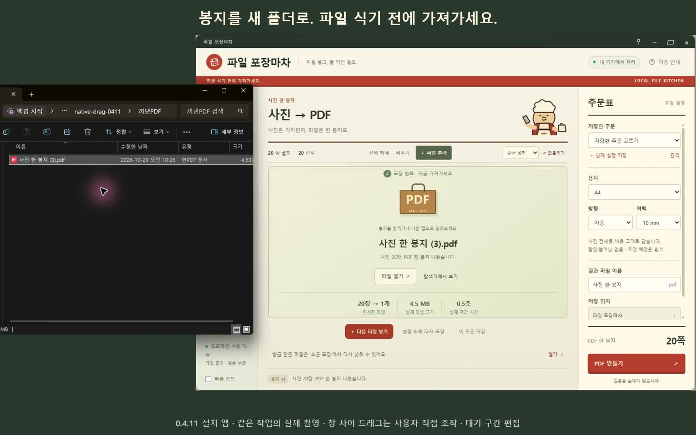

# File Pojangmacha

**Twenty photos. One bag of PDF. Order up.**

A tiny Korean street-food stall for your Windows desktop. Drop in real files, check their order on the counter, and take away a real PDF or resized images. Processing stays on your computer. No account or payment required.

[Download free beta 0.4.11 for Windows x64](https://github.com/qkdlsem-maker/file-pojangmacha/releases/tag/v0.4.11-beta.1) · [한국어](README.md) · [Report a problem](https://github.com/qkdlsem-maker/file-pojangmacha/issues/new/choose)

## What's on the menu?

- **Photos to PDF:** thumbnails, cover selection, reorder/exclude, A4/A5/Letter, orientation and margins. The preview shows a fit without cropping or stretching.
- **Merge PDFs:** select pages and arrange their order.
- **Extract/split PDF:** save selected pages together or as separate files.
- **Batch image resize:** long edge or maximum width/height, keep aspect ratio, PNG/JPG output.
- **Your usual order:** save, edit and delete named settings, optionally with a destination folder.

The stall folds down when idle. Move, minimize or close it easily. Quick mode reduces animation without delaying finished work. Recent results, explicit image paste and Explorer's Send to entry are available.

## Install and use

1. Download **FilePojangmacha-0.4.11-Setup-x64.exe** from the release. GitHub's automatic source ZIP is not the installer.
2. Install and launch, then drop photos from Explorer onto the small stall, or use the file picker.
3. Check the cover, order and selected pages. Choose settings and destination on the order slip.
4. Cook, then open the result or drag the large **PDF** lettering on the brown bag into an empty area of an Explorer folder.
5. Reuse a quick order or saved preset next time. Default output: Downloads / 파일 포장마차.

**Free beta, Windows x64, Korean app UI, unsigned.** This English introduction does not imply an English interface. Windows may display a publisher/SmartScreen warning. This is not a signed stable release. Check [validation and limitations](docs/VALIDATION-0.4.11.md). SHA256SUMS.txt lets you compare downloaded files. Updates are manual: download and run the new installer. Uninstall through Windows Settings.

## Watch the actual workflow

[Download/play the new 24-second 0.4.11 demo](https://github.com/qkdlsem-maker/file-pojangmacha/releases/download/v0.4.11-beta.1/FilePojangmacha-0.4.11-native-drag-demo.mp4)

**Newly recorded in installed version 0.4.11.** Explorer drop of 20 photos → cover/order changes → PDF creation → bag dragged into a new empty folder → opening in a PDF viewer. A human performed both cross-window drags and opened the PDF; Windows UI automation operated the intermediate buttons. All clips are from one job at original speed, with waiting removed and private desktop areas masked. The received PDF matched the saved output by hash; all 20 page positions and all 20 unchanged original images were verified. [Native workflow evidence](docs/VALIDATION-0.4.11-NATIVE.md).

## Privacy and originals

No server uploads, accounts, payments, analytics or automatic updates. Originals are preserved. Results use a separate file and a numbered suffix on name conflicts. Cancellation/failure cleans up incomplete job outputs; a sudden power loss may leave `.partial` temporary files.

Presets, the last output folder and paths/sizes for the last 20 result orders are stored in `%APPDATA%\file-pojangmacha`. Input lists disappear on exit. The clipboard is read only when you request paste. Pasted temporary images are deleted on normal exit. Settings and history remain after uninstall; clearing recent history does not delete your files.

## Limits

- JPG, PNG, WebP, single-page TIFF and unencrypted PDF. No HEIC, GIF, SVG, video or OCR.
- Up to 120 files, 150 MB per file, 300 MB total and 400 output pages per order.
- Photo PDFs use JPEG quality 94 and a maximum long edge of 4,000 px. Transparency becomes white. This is not lossless archival storage.
- PDF bookmarks, digital signatures and document attachments are not preserved. Complex forms need separate checking.
- Local NTFS output is tested. FAT/exFAT and some network folders may not support the atomic-save mechanism.
- Tested on one Windows 11 x64 development PC. Another physical PC, Windows 10, ARM64 and varied display scaling remain unverified.

## Source and licenses

Original app code and graphics are [MIT licensed](LICENSE); dependencies retain [their own licenses](THIRD_PARTY_NOTICES.md). No existing character or franchise assets are included. Demo postcards are original generated test images.

See [build instructions](docs/BUILD.md). The release includes source backup, validation evidence, native source materials and rebuild evidence. The installer uses source-rebuilt binaries for 28 image-engine/codec libraries. Electron/Chromium and the host compiler toolchain were not rebuilt from source.

0.4.11 is the requested version number for the first GitHub free beta, not a claim of numerous new features since 0.3.1. Use the [Korean or English issue form](https://github.com/qkdlsem-maker/file-pojangmacha/issues/new/choose). Do not attach private files or personal information to public reports.
